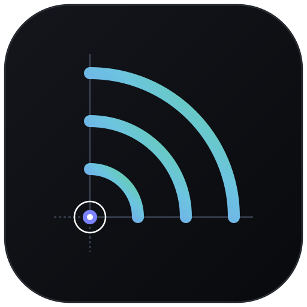

<h1 align="center">rfmap</h1>

<p align="center">
  
</p>

<p align="center">
  <strong>Real-time Wi-Fi survey mapper with coverage heatmaps, floor-plan calibration, AP inventory, and authorized rogue-AP assessment.</strong><br>
  <em>Walk around, click your position, and watch the heatmap build as you measure.</em>
</p>

<p align="center">
  
  
  
  
  
  
  
  
  
</p>

## Developer guide

Start with [the architecture guide](docs/ARCHITECTURE.md) to understand the product boundary and data flow, then use [the development guide](docs/DEVELOPMENT.md) to run and extend it. Each major package also has its own README:

- [Architecture and package map](docs/ARCHITECTURE.md)
- [Tests](tests/README.md)

## Features

### Survey mapper
- **3D OpenGL heatmap** — GPU-accelerated Phong-shaded surface via VisPy
- **Auto router detection** — signal-weighted centroid from your clicks
- **Connected device mapping** — live device names + positions around the router
- **Real-time RSSI** — last point updates automatically when signal changes
- **Wall drawing** — drag to add drywall, brick, or concrete obstacles
- **Floor-plan import** — place a PNG/JPEG floor plan beneath the heatmap
- **Scale calibration** — set metres per grid cell before collecting measurements
- **Adapter and AP selection** — explicitly select the Wi-Fi adapter and AP being surveyed
- **Scrolling waterfall** — live RSSI history overlay
- **Turntable camera** — arrow keys rotate the 3D view
- **Tokyo Night theme** — dark UI throughout

### Threat Scanner
Toggle the **Threat Scanner** panel to access the AP scanner and rogue AP localization tool:
- **AP Scanner** — enumerate all nearby networks (SSID, BSSID, channel, security, RSSI)
- **Rogue Detector** — whitelist-based heuristics flag evil twins, open corporate SSIDs, hidden APs
- **Survey Mode** — click floor points around a target AP to collect RSSI samples
- **Localization Engine** — nonlinear least-squares fit with error ellipse and GDOP
- **3D Threat Overlay** — red ceiling marker, confidence ellipse, drop line on the 3D canvas
- **Reporting** — export survey sessions as JSON/CSV/HTML reports

## Quick Start

```bash
python -m rfmap
```

## Usage

| Action | Result |
|---|---|
| Click on floor | Record signal measurement |
| Click-drag | Draw a wall |
| Arrow keys | Rotate camera |
| Auto-sample checkbox | Auto-record every 1s |
| Import Floor Plan | Add an image of the surveyed space |
| Scale | Set the real-world metres represented by each grid cell |
| Refresh Access Points | Scan, then select an AP for survey readings |
| Load DEMO Data | Load clearly labelled synthetic data; clear it before a real survey |
| Threat Scanner | Open AP scanner + rogue AP survey |

## Architecture

Three decoupled pipelines on separate threads:

1. **Wi-Fi** (`rfmap/wifi/`) — OS-level RSSI polling; unavailable hardware never falls back to fake readings
2. **Heatmap** (`rfmap/core/`) — Gaussian blob kernel regression, physics path-loss model, router estimation
3. **UI** (`rfmap/ui/`) — PyQt6 window with VisPy OpenGL 3D canvas

## Platform Support

| OS | Method | Permissions |
|---|---|---|
| Linux | `nmcli` first, then unprivileged `iw` | No `sudo` prompt; enable NetworkManager for best results |
| Windows | `netsh wlan show interfaces` | None needed |
| macOS | `airport -I` | May be missing on Ventura+ |

## Calibration

Use the **Scale** control in the app to set metres per grid cell. RFMap applies it to the path-loss model and displays the total surveyed map size.

## Live-data policy

RFMap never substitutes simulated RSSI or AP results when live Wi-Fi access fails. Demo data is an explicit action and remains visibly labelled until cleared. Do not export or rely on demo data for a real survey.

## Linux scan setup

RFMap first uses NetworkManager's `nmcli`, which normally works without elevated privileges. If it is unavailable it tries `iw` without `sudo`; it will show setup guidance instead of opening a password prompt or inventing scan results. Connect a Wi-Fi adapter and enable NetworkManager to use AP scanning.
